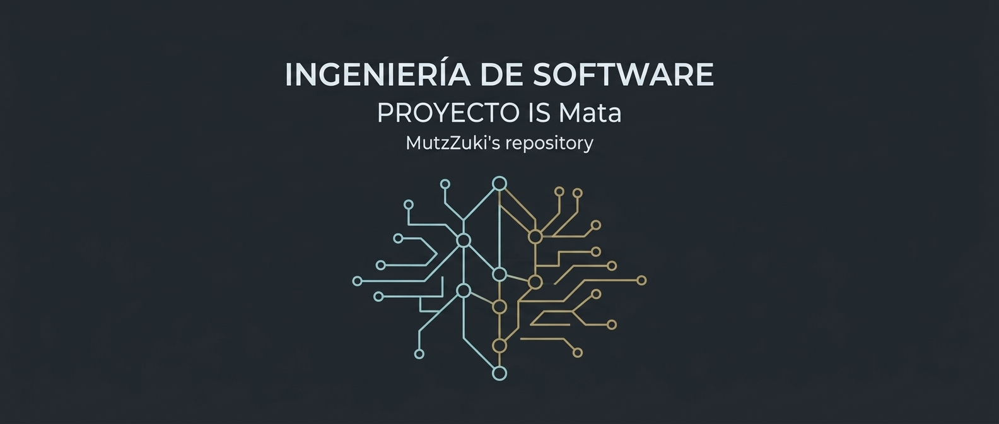

  

# Practica 2 2° Parcial IS Mata 

## Ejercicio de GitHub

### Ingeneria de Software Mata UDL

**Fases del ciclo de vida de desarrollo de software**
<!-- -->
1 Planeacion
2 Analista
3 Diseño
4 Desarrollo
5 Pruebas
